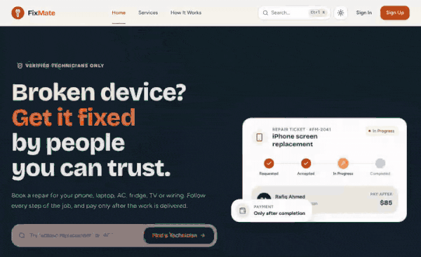

# FixMate — Client (Next.js)

<p align="center">
  
</p>

On-demand device & home appliance repair booking platform. Verified **technicians** list repair services, **customers** request repairs, track each job step by step and pay with Stripe only after completion, and **admins** moderate listings, users and revenue.

> **Status: Full-stack.** The Next.js client uses BetterAuth, and data/payment workflows call the Express + MongoDB API with JWT role middleware and Stripe.

- **Live URL:** https://fixmate-client1.vercel.app
- **Server repository:** https://github.com/seman2-Dev/fixmate-server
- **Server API:** https://fixmate-server1.vercel.app

## Demo credentials

| Role | Email | Password |
| --- | --- | --- |
| Admin | `admin@fixmate.dev` | `FixMate1@admin` |
| Technician | `rafiq@fixmate.dev` | `FixMate1@technician` |
| Customer | `emran@fixmate.dev` | `FixMate1@customer` |

Payment test card (mock checkout, same as Stripe test mode): `4242 4242 4242 4242`, any future date, any CVC.

## Design system

"Workshop Warm": warm paper surfaces, deep ink navy and one accessible orange (`--primary` #c2410c). Tokens are shadcn semantic variables in `src/app/globals.css` (`--primary`, `--card`, `--sidebar-*` …) plus the `ink-*` / `brand-*` scales. Status colours: Requested blue, Accepted indigo, In Progress amber, Completed green, Rejected red, Cancelled gray.

## Extras

- Dark theme (toggle in navbar and dashboard header, saved in `localStorage`, follows the OS on first visit)
- `Ctrl/⌘ + K` command palette for pages, categories, services and actions
- Sortable, paginated data tables; all tables become labelled cards on phones

## Key features

- Role-based experience for Customer, Technician and Admin with a sticky navbar, role badge and avatar menu
- Home: hero search, 6 latest approved services (equal-height cards), How It Works, popular categories, trust stats, testimonials
- `/services` search, category and mode filters and sort, all driven by URL params (survive reload; `/services?category=AC` deep links work)
- Service details with a role-restricted repair request form (phone, address, date, 20+ char problem), duplicate-active-request guard
- Job pipeline Requested → Accepted → In Progress → Completed (Rejected / Cancelled), only valid actions shown, final amount set on completion
- Pay Now only for completed + unpaid jobs; success page verification is idempotent (never saves a payment twice)
- Responsive dashboard layout with collapsible sidebar, stat cards and SVG charts, consistent status badges
- Technician service CRUD with approval reset on edit, availability toggle and image upload
- Admin: user roles (cannot change own), service approval, all bookings, transactions with total revenue
- Custom 404, error boundary, loading skeletons, toasts, empty states and confirmation modals
- Protected routes that wait for the session, so reloading a private route never bounces a signed-in user

## Tech and packages

Next.js 16 (App Router), React 19, TypeScript, Tailwind CSS 4, **shadcn/ui** (new-york style, hand-added components in `src/components/ui` on `radix-ui` + `class-variance-authority`), `lucide-react` (icons), `cmdk` (command palette), `@tanstack/react-table` v8 (sortable, paginated tables), `sonner` (toasts), `clsx` + `tailwind-merge`, `@fontsource-variable/bricolage-grotesque` and `@fontsource-variable/figtree` (self-hosted fonts). Charts are hand-written SVG (no chart dependency). All animation is native CSS (transitions/keyframes + one IntersectionObserver reveal helper) and respects `prefers-reduced-motion`; no animation library.

Phase 2 adds: BetterAuth (MongoDB adapter), Stripe, ImgBB.

## Getting started

```bash
npm install
npm run dev      # http://localhost:3000
npm run build && npm start
```

### Environment variables

Configure `.env.local` (never committed) with:

```dotenv
MONGODB_URI=mongodb+srv://...
DB_NAME=fixmatedb
BETTER_AUTH_SECRET=...
BETTER_AUTH_URL=http://localhost:3000
BETTER_AUTH_TRUSTED_ORIGINS=https://your-client-domain.vercel.app
BETTER_AUTH_GOOGLE_CLIENT_ID=...
BETTER_AUTH_GOOGLE_CLIENT_SECRET=...
NEXT_PUBLIC_API_URL=http://localhost:5000
```

Create Google OAuth credentials with the callback URL
`http://localhost:3000/api/auth/callback/google`.

## Project structure

```
src/app/(public)   Home, services, service details, about, sign-in, sign-up
src/app/dashboard  customer / technician / admin / profile (guarded layout)
src/app/payment    success and cancel verification pages
src/components     ui primitives, layout, home, services, dashboard, charts
src/lib            BetterAuth, JWT API client, types and helpers
```
